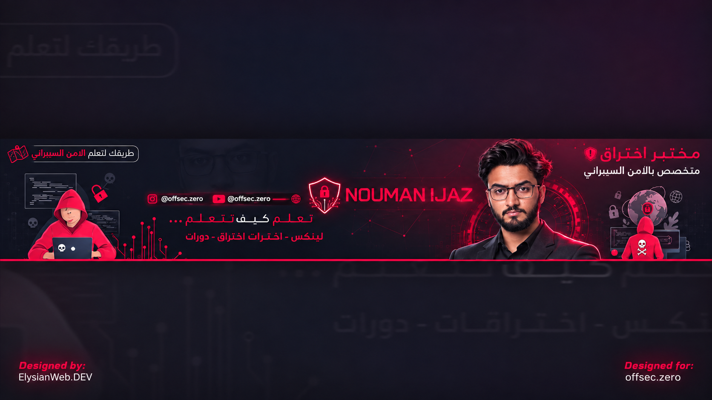

<div align="center">
  
</div>

<div align="center">

# Nouman Ijaz

### `Cybersecurity Student` · `Secure Software Engineering` · `AI / ML`

<a href="#about">About</a> ·
<a href="#focus">Focus</a> ·
<a href="#projects">Projects</a> ·
<a href="#connect">Connect</a>

<br />


<br />

<a href="https://github.com/offsec-zero"></a>
<a href="https://www.instagram.com/offsec.zero/"></a>
<a href="https://www.youtube.com/@offsec-zero"></a>

</div>

---

<a id="about"></a>

##  About me

I’m **Nouman Ijaz**, a cybersecurity student from Pakistan interested in secure software engineering, artificial intelligence, machine learning, deep learning, and research-oriented technical work.

I care about systems that are useful, inspectable, and responsibly built. My goal is to develop practical skills at the intersection of **security** and **intelligent systems**, while documenting the methods, evidence, and limitations behind my work.

> **Working principle:** technical claims should be backed by evidence—not decoration.

##  Professional direction

<table>
  <tr>
    <td width="50%" valign="top">
      <h3>What I am developing</h3>
      <ul>
        <li>Cybersecurity foundations and defensive thinking</li>
        <li>Secure software engineering habits</li>
        <li>Python-based AI/ML experimentation</li>
        <li>Research documentation and technical communication</li>
      </ul>
    </td>
    <td width="50%" valign="top">
      <h3>Where I am heading</h3>
      <ul>
        <li>Security engineering and application security</li>
        <li>AI security and trustworthy ML systems</li>
        <li>Computer vision evaluation and deepfake detection</li>
        <li>Research at the AI, security, and quantum ML intersection</li>
      </ul>
    </td>
  </tr>
</table>

<a id="focus"></a>

##  Focus areas

<table>
  <tr>
    <td width="50%" valign="top">
      <h3>🛡️ Cybersecurity</h3>
      <p>Security fundamentals, threat-aware thinking, and responsible technical practice.</p>
    </td>
    <td width="50%" valign="top">
      <h3>⚙️ Secure engineering</h3>
      <p>Building clear, maintainable systems with verification and reliability in mind.</p>
    </td>
  </tr>
  <tr>
    <td width="50%" valign="top">
      <h3>🧠 AI &amp; machine learning</h3>
      <p>Model development, evaluation, deep learning, and reproducible experiments.</p>
    </td>
    <td width="50%" valign="top">
      <h3>🔬 Research</h3>
      <p>Computer vision, AI security, and quantum machine learning as developing interests.</p>
    </td>
  </tr>
</table>

<div align="center">


</div>

##  Skills & technologies

The technologies below represent areas I am learning, using in project planning, or developing further. They are not a claim of expert-level certification or production mastery.

<table>
  <tr>
    <td width="33%" valign="top">
      <h3>💻 Programming</h3>
      
      
      
      
      <p><sub>Core programming, web foundations, and problem solving.</sub></p>
    </td>
    <td width="33%" valign="top">
      <h3>🤖 AI / ML</h3>
      
      
      
      
      <p><sub>ML experimentation, model evaluation, and computer vision research direction.</sub></p>
    </td>
    <td width="33%" valign="top">
      <h3>🛡️ Security & tooling</h3>
      
      
      
      
      <p><sub>Version control, technical documentation, and security-oriented learning.</sub></p>
    </td>
  </tr>
</table>

### Engineering checklist

```text
[✓] Understand the problem and define its scope
[✓] Identify assumptions, assets, risks, and limitations
[✓] Keep implementation work version-controlled
[✓] Evaluate outcomes instead of relying on claims
[✓] Document evidence, decisions, and future improvements
```

<a id="projects"></a>

##  Current work

| Project | Focus | Current status |
| :-- | :-- | :-- |
| **DeepShield-Vision** | Computer Vision · AI Security | 🟠 **On hold** — blueprint prepared for a planned CNN vs. Vision Transformer deepfake-detection comparison. |
| **LogShield** | Cybersecurity · Engineering | 🟠 **On hold** — planned security-focused engineering project. |

<details>
<summary><b>How I present projects</b></summary>
<br />
Planned, in-progress, and completed work are never treated as the same thing. Results, public repositories, demos, metrics, and credentials will be shared only after implementation, review, and verification.
</details>

### DeepShield-Vision — planned research outline

| Layer | Planned scope |
| :-- | :-- |
| **Problem** | Investigate manipulated-image detection through a structured, comparative study. |
| **Approach** | Compare CNN and Vision Transformer architectures using transparent evaluation criteria. |
| **Evidence standard** | Report datasets, splits, metrics, compute constraints, baselines, and limitations. |
| **Publication rule** | Publish code, outcomes, and claims only after implementation and review. |

### LogShield — planned engineering outline

| Layer | Planned scope |
| :-- | :-- |
| **Direction** | Security-focused engineering project. |
| **Status** | On hold; a blueprint exists, but no implementation or public outcome is claimed. |
| **Future evidence** | Architecture decisions, source code, validation approach, and project documentation. |

##  Method

```text
Research  →  Build  →  Evaluate  →  Document
```

- Start with the problem, scope, and security implications.
- Build deliberately and keep assumptions visible.
- Evaluate outcomes instead of overstating them.
- Document evidence, limitations, and next steps.

##  Learning roadmap

<table>
  <tr>
    <th align="left">Stage</th>
    <th align="left">Focus</th>
    <th align="left">Evidence I plan to publish</th>
  </tr>
  <tr>
    <td><b>Foundation</b></td>
    <td>Programming, Linux, networking, Git, and cybersecurity fundamentals.</td>
    <td>Clear notes, documented practice, and well-scoped repositories.</td>
  </tr>
  <tr>
    <td><b>Build</b></td>
    <td>Secure engineering exercises, automation, and applied AI/ML projects.</td>
    <td>Source code, setup instructions, tests, and project decisions.</td>
  </tr>
  <tr>
    <td><b>Evaluate</b></td>
    <td>Model comparison, threat-aware testing, and reproducible experiments.</td>
    <td>Metrics with context, failure cases, limitations, and methodology.</td>
  </tr>
  <tr>
    <td><b>Contribute</b></td>
    <td>Open source, research collaboration, and technical writing.</td>
    <td>Reviewed contributions, case studies, and public technical artifacts.</td>
  </tr>
</table>

##  GitHub activity

<div align="center">
  <a href="https://github.com/offsec-zero">
    
  </a>
  <a href="https://github.com/offsec-zero">
    
  </a>
</div>

<div align="center">
  
</div>

##  Collaboration & values

I welcome thoughtful conversations about cybersecurity, secure engineering, AI/ML, research practice, and building a stronger technical portfolio through real work.

| I value | What it means here |
| :-- | :-- |
| **Accuracy** | Do not present a plan, enrollment, or interest as a completed accomplishment. |
| **Security** | Treat privacy, boundaries, and responsible disclosure seriously. |
| **Evidence** | Link work to its source, methodology, or verifiable artifact where possible. |
| **Growth** | Share the learning process without pretending to know everything already. |

<a id="connect"></a>

##  Connect

<div align="center">
<a href="https://github.com/offsec-zero"></a>
<a href="https://www.instagram.com/offsec.zero/"></a>
<a href="https://www.facebook.com/offsec.zero/"></a>
<a href="https://www.tiktok.com/@offsec.zero"></a>
<br />
<a href="https://www.pinterest.com/offsec_zero/"></a>
<a href="https://www.threads.com/@offsec.zero"></a>
<a href="https://www.youtube.com/@offsec-zero"></a>

<br /><br />

<sub>© 2026 Nouman Ijaz · <b>OFFSEC ZERO</b> · Building deliberately. Documenting honestly.</sub>
</div>
